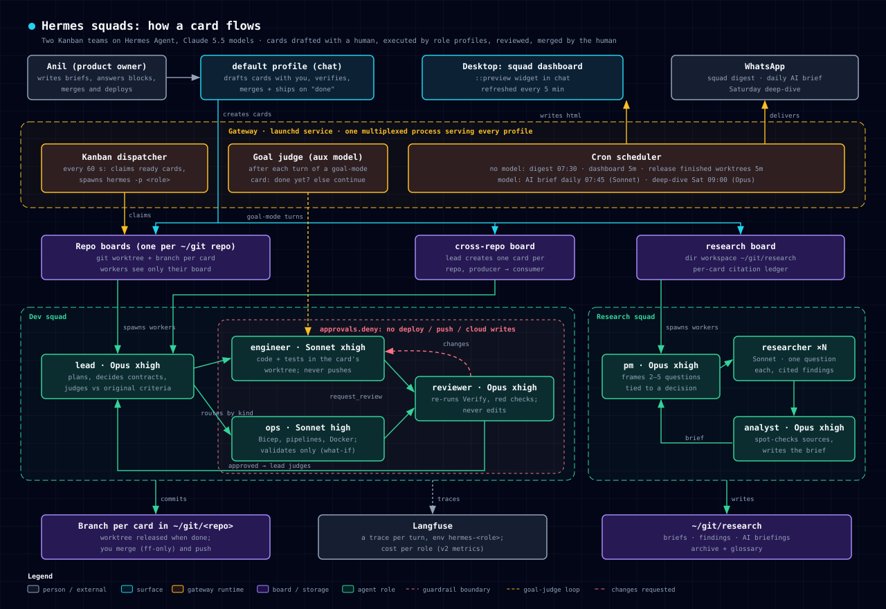

# hermes-squad

A record of how I built two AI agent teams on [Hermes Agent](https://hermes-agent.nousresearch.com/docs/) while learning AI/context engineering: what the setup is, why it's shaped this way, what went wrong, and how it compares with where the industry is heading.

Started 11 Oct 2026. Hermes v0.21.x, Anthropic Claude 5.5 models.

*Regenerate with `python3 scripts/render_architecture.py`.*

## Read in this order

| Doc | What it answers |
|---|---|
| [01 Architecture](docs/01-architecture.md) | What the squads are, how a card flows, what runs where |
| [02 Context engineering](docs/02-context-engineering.md) | What each agent sees, which layer each kind of information lives in, and the rules learned |
| [03 Industry alignment](docs/03-industry-alignment.md) | How this setup compares with current practice and research, with sources: where it aligns, where it lags |
| [04 Learnings](docs/04-learnings.md) | Dated lessons, each with the evidence and the change it led to |
| [05 Metrics](docs/05-metrics.md) | Scorecard snapshots and how to recompute them |
| [06 Roadmap](docs/06-roadmap.md) | Known gaps, ranked, with status |
| [Runbook](docs/runbook.md) | Day-to-day operation: new cards, blocks, pausing, merging, adding repos and roles |

## What's in the repo

- `team/` is a **generated snapshot** of the live team: each role's `SOUL.md`, model, thinking level, tools and guardrails, kanban settings, and agent-made skills (with a drift report). Regenerate it with `python3 scripts/snapshot_team.py` after any change, then commit, so every context change is a dated, reviewable diff. It contains no secrets (`.env`, auth and memories are never read).
- `scripts/hermes/` holds copies of the helper scripts the setup runs from `~/.hermes/scripts/`.
- `research/` holds the research team's two briefs that this design draws on, copied from `~/git/research` (which isn't under version control).

**Source of truth today:** the live files in `~/.hermes/profiles/`. This repo snapshots them. Making the repo the source and syncing *into* Hermes is on the roadmap.
