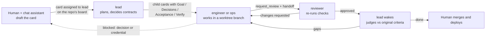

# 01 Architecture

*As of 15 Oct 2026. The authoritative settings are in [`team/`](../team).*

## Building blocks

Hermes has no "team" object. A team is **profiles** (one per role) plus the **Kanban boards** they work from, with one dispatcher running everything.

| Hermes primitive | What it gives a role | Used for |
|---|---|---|
| Profile (`~/.hermes/profiles/<role>/`) | Its own `SOUL.md` (identity and rules), model, thinking level, toolsets, memory, skills, command deny-list | One profile per role |
| Profile description | The one-line role summary the Triage decomposer routes by | Keeping work on the right team |
| Kanban board | A durable SQLite work queue: cards, dependencies, runs, comments, handoffs | One board per repo, plus `cross-repo` and `research` |
| Dispatcher (inside the gateway, launchd service) | Every 60 s, starts `hermes -p <assignee>` for each ready card, as a separate process with an empty context | Running the work |
| Review lane | `kanban_request_review` → reviewer → approve or `kanban_request_changes` | An independent check on every implementation card |
| Workspaces | `worktree` (git worktree + branch per card), `dir` (shared folder), `scratch` (deleted at completion) | Code goes in worktrees, research in `~/git/research` |

## The two squads

| Team | Role | Model / thinking | Tools | Job |
|---|---|---|---|---|
| Dev | `lead` | Opus 5.5 / xhigh | file, kanban, memory (no terminal or web) | Plans and frames cards, decides shared contracts, routes work, judges completion against the original criteria. Never implements. |
| | `engineer` | Sonnet 5.5 / xhigh | dev toolset | Application code (.NET backend; Blazor, MAUI, React Native frontend) in a worktree. Pinned `backend-` / `frontend-conventions` skills. Always ends with a review request. |
| | `ops` | Sonnet 5.5 / high | dev toolset | Bicep/ARM for Azure PaaS, GitHub Actions, Dockerfiles, k8s. **Validates only** (build, lint, what-if); deploy commands are blocked at the tool level. Handoff lists manual deploy steps. |
| | `reviewer` | Opus 5.5 / xhigh | dev toolset, read-only cloud | Re-runs the checks, approves or requests changes, never edits. `sdlc-review` + conventions + `azure-paas-iac` skills. |
| Research | `pm` | Opus 5.5 / xhigh | file, kanban, memory | Turns a loose idea into 2–5 research questions tied to a decision; judges the final brief. |
| | `researcher` | Sonnet 5.5 / medium, compresses at 120K | web, browser, terminal | Answers one question with cited findings (per-card citation ledger). |
| | `analyst` | Opus 5.5 / xhigh, compresses at 150K | web, browser, terminal | Spot-checks claims against sources, writes the decision brief. |

The default profile (me, in chat) is off-team. It's where cards get drafted with the human.

## How a card flows (dev)

- **Cross-repo:** the `cross-repo` board, card assigned to `lead`; one child per repo with `project=<repo>`, ordered producer → consumer.
- **Research:** card on `research` assigned to `pm` → researcher cards in parallel → analyst card (its parents are all the researcher cards) → pm judges.
- **Between teams:** only through the human. A research recommendation becomes a dev card via the chat-first drafting workflow.
- **Triage is a holding pen, not a queue.** `kanban.auto_decompose` is off, so rough ideas parked in Triage (assigned to the lead, body shaped *Status / Problem / What we know / Ideas / Open questions*) stay there until the human moves them or clicks Decompose.

## Guardrails

| Risk | Control | Strength |
|---|---|---|
| Agents change live infrastructure | `approvals.deny` per profile: ops and reviewer can read and validate only; the other roles have no `az` / `azd` / `kubectl` / `helm` / `terraform` | Hard for terminal commands, including inside scripts that call the terminal tool. A raw `subprocess` in Python gets around it. |
| Unreviewed code ships | Review lane; engineer and ops SOUL say "never `kanban_complete`"; human merges | Process plus SOUL rule (no tool-level gate) |
| Pushing or merging | Blocked for ops and reviewer; SOUL rule for the engineer | Mixed |
| Runaway cost | `max_in_progress: 4`, per-role compression, the "no verbatim-quote checking" rule for researchers | Soft |
| Editing instruction files | Only the engineer and ops may edit `AGENTS.md`/`CLAUDE.md`; the reviewer scrutinises those diffs | Config plus review |

**Known weakness:** every profile shares the real `$HOME`, so your CLI logins (`az`, `gh`, git credentials) are reachable by every agent. The deny lists cover the risky verbs, not the credentials themselves.

## Supporting machinery

| Piece | Where | Purpose |
|---|---|---|
| `kanban-repo-boards.sh` | `~/.hermes/scripts/` | Creates a repo-linked board for each `~/git` repo (the CLI's `project create --board` doesn't link them properly) and copies the project records to the team profiles |
| `kanban_release_worktrees.py` | cron, every 5 min, no model calls | Removes finished cards' worktrees and keeps the branches, so the human works on plain branches |
| `sync_langfuse_env.py` | `~/.hermes/scripts/` | Copies the Langfuse keys to every profile and sets `HERMES_LANGFUSE_ENV=hermes-<profile>` |
| Langfuse plugin | every profile | Per-role traces, tokens and cost, kept apart from app traces by environment |
